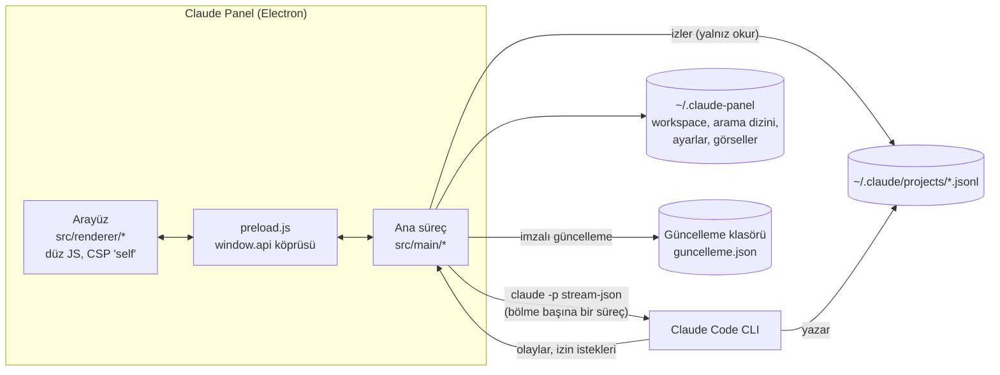

<div align="center">


# Claude Panel

**Claude Code sohbetlerini klasörlerde toplayan, yan yana çalıştıran ve Claude Code ile canlı senkron tutan masaüstü kokpiti.**

*A desktop cockpit for Claude Code: organize sessions in folders, run up to four side by side, stay in live sync with the CLI.*


</div>

---

## Neden?

Claude Code güçlü ama tek pencereli bir terminal deneyimi. Gün boyu onlarca müşteri işi, video projesi ve kod deposu arasında gidip gelen biri için şu sorunlar birikir:

| Claude Code'da | Claude Panel'de |
|---|---|
| Her çalışma klasörü ayrı bir proje olarak listede birikir | Sohbetler **sanal klasörlerde** toplanır: iç içe, renkli, sürükle-bırak, sabitlenebilir |
| Aynı anda tek sohbet görünür | **1 / 2 / 3 sütun ya da 2×2** bölme; her bölme kendi `claude` sürecini paralel çalıştırır |
| Eski bir konuşmayı bulmak zor | **Tam metin arama** (SQLite FTS5, Türkçe karakter duyarsız) |
| Masaüstü uygulaması ile terminal ayrı dünyalar | `~/.claude/projects` **canlı izlenir**: CLI'de ya da Claude uygulamasında açılan sohbet anında panelde görünür, panelden yazılan mesaj CLI'de aynen görünür |

Panel kendi anahtarını tutmaz; kullanıcının mevcut Claude Code girişini kullanır ve `claude` CLI'yi başsız (`-p --input-format stream-json`) çalıştırır.

## Öne çıkanlar

### Çalışma düzeni
- **Bölmeler:** 1–4 sohbet yan yana, her biri bağımsız çalışır; çalışırken yazılan mesajlar **sıraya** girer, sıradakiler görülür, düzenlenir, silinir.
- **Sohbetler panosu:** klasör ağacı, sürükle-seç, toplu taşıma, Çöp Kutusu, ada/tarihe göre sıralama, GourceView ilişki haritası.
- **Arama:** bütün oturumlarda anında arama, sonucu istenen bölmede açma.
- **Bilgi paneli:** ortam, gerçek bağlam doluluğu, değişen dosyalar, son medya, arka plan görevleri, bağlayıcılar.

### Claude Code ile eşdeğer özellikler
- **`/` menüsü:** yerleşik komutlar, kullanıcı ve proje skill'leri, şablonlar tek menüde; yazdıkça süzülür, klavyeyle seçilir.
- **`@dosya`:** çalışma klasöründen dosya yolu tamamlama.
- **↑ / ↓ geçmiş**, gönderilmiş mesajı **düzenleyip o noktadan devam etme** (geri sarma).
- **Görev listesi kartı** (TodoWrite), **alt ajan** blokları (katlanabilir), **düşünme** blokları (varsayılan gizli, tıklayınca açılır).
- **Arka plan görevleri:** `run_in_background` komutları ayrı listede; durum, son çıktı ve gerçek durdurma (`stop_task`).
- **Toplu fark ve geri alma:** oturum boyunca değişen bütün dosyalar, oturum başı ↔ şimdi farkı; dosya bazında onaylı geri alma (önce yedek, oluşturulan dosya Geri Dönüşüm Kutusuna).
- **Bağlam ve maliyet:** gerçek bağlam kullanımı, `/compact` düğmesi ve otomatik sıkıştırma bildirimi; oturum maliyeti ve token'ı; planın kalan kullanımı ve "bu hızla ne zaman biter" tahmini.
- **Claude ayarları:** CLAUDE.md hafıza dosyaları, `#` ile hızlı not, izin kuralları (allow / deny / ask), hook'lar, output style, statusline, eklentiler ve ajanlar; JSON kaydetmeden önce doğrulanır, bozuk ayar yazılmaz.
- **Dışa aktarma:** sohbeti Markdown dosyası olarak kaydetme.
- **Ek klasör (`--add-dir`) ve worktree** ile ayrı dalda yeni oturum.

### Medya ve görsel iş akışı
- Mesajdaki görsel ve video yolları tıklanınca panelde açılır; oynatıcı videonun kendi oranındadır.
- **Ekran görüntüsüne çizim:** eklenen ya da yapıştırılan görselin üzerine göndermeden önce kalem, ok, kutu ve yazı ile işaretleme; geri al / yinele.
- Sesli yazma (Windows: Win+H), bildirimler ve görev çubuğu sayacı.

### Bilgisayar kontrolü
- Tarayıcı için Claude in Chrome, masaüstü için erişilebilirlik tabanlı `agent-desktop`.
- Ekranı görerek çalışma: kod ve API yetmediğinde Claude ekran görüntüsü alıp imleçle tıklayabilir. Kullandığı monitörün kenarında panele özgü bir **çerçeve animasyonu** çıkar; **Ctrl+Alt+Esc** her şeyi anında durdurur.

### Görünüm
- Varsayılan **Gece** teması (nötr, neredeyse siyah, ince kenarlıklar, WCAG AA kontrast); eski Claude tonlu koyu tema, açık tema ve sistemi izleme seçenekleri.
- Gömülü OFL yazı tipleri (Inter, JetBrains Mono ve diğerleri), 8-bit köpekli çalışma göstergesi.

## Mimari



| Modül | Görev |
|---|---|
| `main/main.js` | Pencere, menü, tüm IPC (yalnız kendi sayfasından gelen istekler kabul edilir), `cpmedia://` medya protokolü |
| `main/runner.js` | `claude` sürecini başlatır, girdileri doğrular, izin isteklerini arayüze taşır, Windows süreç ağacını düzgün kapatır |
| `main/sessions.js` | Oturum özetleri ve artımlı okuma; araçlar, görseller, kartlar, alt ajanlar |
| `main/search.js` | SQLite FTS5 tam metin arama |
| `main/workspace.js` · `main/mirror.js` | Atomik kayıt, `.bak` yedeği, diskteki yansıdan kurtarma |
| `main/updater.js` · `main/macupdate.js` | Ed25519 imzalı, SHA-512 doğrulamalı güncelleme (Windows sessiz kurulum, Mac paket değiştirme) |
| `main/changes.js` · `main/claudecfg.js` | Dosya geri alma ve Claude yapılandırma dosyaları (yalnız bilinen yollar, atomik yazım) |
| `renderer/app.js` | Durum, bölmeler, mesaj akışı; ekranı baştan kurmadan yamalayarak çizer |
| `renderer/*.js` | Saf, test edilebilir modüller (`markdown`, `diff`, `changes`, `menupos`, `mediapath`, `tema`, `annotate` …): tarayıcıda `window.X`, Node'da `module.exports` |

## Kurulum

### Kullanıcı
1. Claude Code CLI kurulu ve giriş yapılmış olmalı (`claude --version`).
2. **Windows:** `Claude Panel Setup <sürüm>.exe` dosyasını çalıştırın. Uygulama güncelleme klasörünü düzenli denetler, yeni sürümü arka planda indirip doğrular; "Yeniden başlat ve güncelle" ile kurulur.
3. **macOS (Apple Silicon):** DMG'deki uygulamayı Applications klasörüne sürükleyin. Uygulama ad-hoc imzalıdır; ilk açılışta sağ tık → Aç gerekebilir. Yeni sürüm çıktığında uygulama bildirir ve kendini değiştirir; olmazsa DMG ile elle güncelleme yönergesi gösterir.

### Geliştirici
```bash
git clone https://github.com/modernzamanlar/claude-panel.git
cd claude-panel
npm ci
npm start
```

| Komut | Ne yapar |
|---|---|
| `npm start` | Geliştirme modunda açar |
| `npm test` | Bütün birim testleri, kendi geçici klasöründe (bitince silinir) |
| `npm run test:cov` | Saf modüllerin kapsamı (%100 tutulur) |
| `npm run test:ui` | Uygulama içi uçtan uca test: sahte `claude` CLI ile, Mac ve Windows görünümünde |
| `npm run dist` / `npm run dist:win` | macOS DMG + ZIP / Windows NSIS kurulumu |

Uygulama içi test (`--selftest`) her zaman geçici `CLAUDE_PANEL_HOME` ve `CLAUDE_PANEL_MIRROR` ile çalışır; gerçek veriye dokunmaz. Ayrıntılar: [`CLAUDE.md`](CLAUDE.md), sürüm geçmişi: [`PLAN.md`](PLAN.md).

## Veri ve gizlilik

- `~/.claude/projects` **yalnız okunur**; panel Claude'un kayıtlarını hiçbir zaman değiştirmez.
- Panelin kendi verisi `~/.claude-panel/` altındadır: çalışma düzeni (`workspace.json` + `.bak`), arama dizini, ayarlar, görsel önbelleği, geri alınan dosyaların yedekleri.
- Parola, API anahtarı ya da token saklanmaz; giriş Claude Code'un kendisindedir.
- Uzak medya adresleri tıklanana kadar yüklenmez.

## Güvenlik modeli

- Arayüz `contextIsolation`, `sandbox` ve sıkı CSP ile çalışır; Node erişimi yoktur.
- Her IPC çağrısında göndericinin uygulamanın kendi sayfası olduğu denetlenir.
- Dosyaya yazan her işlem (geri alma, Claude ayarları, çizim kaydı) yol doğrular, sembolik bağları reddeder, atomik yazar ve önce yedek alır.
- Güncellemeler Ed25519 ile imzalanır, paketler SHA-512 ile doğrulanır; imzası tutmayan sürüm kurulmaz.
- Kabuk komutları dize birleştirerek kurulmaz; argümanlar ayrı verilir.

## Bilinen sınırlar

- Windows kurulumu Authenticode ile imzalı değil: ilk çalıştırmada SmartScreen uyarısı çıkabilir.
- macOS sürümü Apple geliştirici sertifikası olmadan, ad-hoc imzalıdır.
- Bazı Claude Code özellikleri başsız (`-p`) modda CLI tarafından sunulmadığı için panelde yer almaz; panel bunları taklit etmez.

## Lisans

Tescilli yazılım. Tüm hakları saklıdır (`UNLICENSED`). Gömülü yazı tiplerinin lisansları: [`src/renderer/fonts/LICENSES.txt`](src/renderer/fonts/LICENSES.txt).

<div align="center"><sub>Claude Code ile, Claude Code için yapıldı. 🐶</sub></div>
